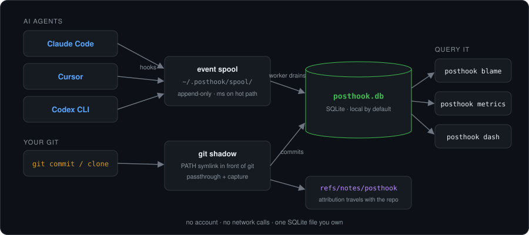
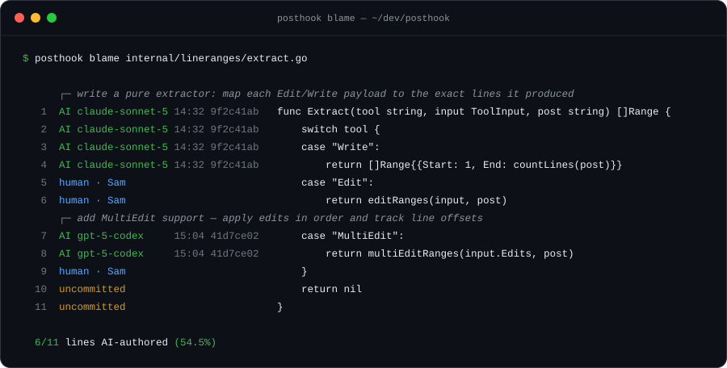
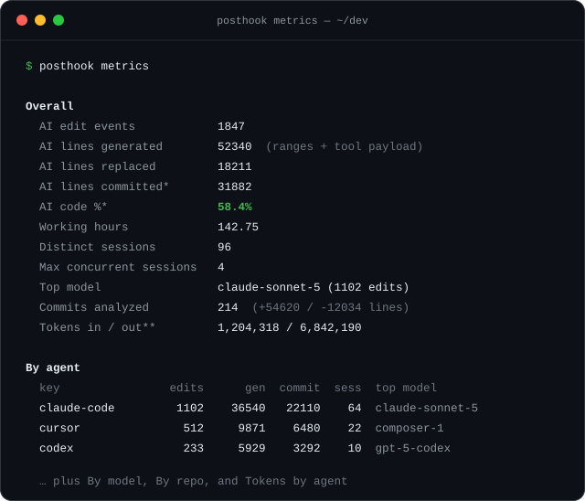
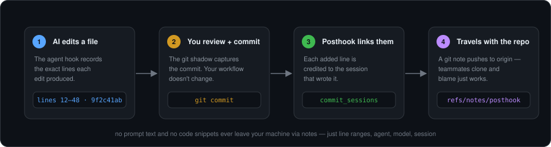

<div align="center">

# posthook

**Local-first instrumentation for AI-assisted coding.**

Posthook tells you which lines of your codebase were written by an AI agent, by which model, from which session — and ties all of it back to the git commits that shipped it.

</div>

---

Posthook installs hooks into the AI coding tools you already use (Claude Code, Cursor, Codex CLI, GitHub Copilot) and a lightweight `git` shadow that sits in front of every git command on your machine. It captures both sides — what the AI did, and what you committed — into a single SQLite file you can query, browse in a web dashboard, or attribute line-by-line with `posthook blame`.

Everything runs on your laptop by default. No account, no network calls, no telemetry. The data is yours, in a file you can open with any SQLite client.

<p align="center">
  
</p>

## Why posthook

As more of your code is written by AI, the basic questions get hard to answer:

- **How much of this codebase is AI-written, and by which models?**
- **Who reviewed the AI's work before it shipped — and which commits are pure AI vs. human-edited?**
- **When something breaks, which AI session produced the line?**

Posthook answers these without changing your workflow. You keep using your editor and your agents exactly as before; posthook records the trail in the background and links it to your git history. Attribution travels with the repo (in git notes), so a teammate who clones it can run `posthook blame` and see the same answers — no setup, no sync.

<p align="center">
  
</p>

<p align="center">
  
</p>

## Quickstart

```bash
# 1. Install the latest release (prebuilt CLI + dashboard) into ~/.local/bin.
#    No Go or Node needed to install — it downloads a static binary.
curl -fsSL https://raw.githubusercontent.com/Bilanc/posthook/main/install.sh | sh

# 2. Make sure ~/.local/bin precedes the real git on your PATH (usually /usr/bin):
export PATH="$HOME/.local/bin:$PATH"

# 3. Install hooks + the git shadow (idempotent; safe to re-run):
posthook init

# 4. After using Claude Code / Cursor / Codex / Copilot for a while:
posthook status                 # is everything wired up and capturing?
posthook metrics                # AI vs. human, by agent/model/repo
posthook blame path/to/file.ts  # per-line attribution
posthook dash                   # open the web dashboard (needs Node >=24)
```

`posthook init` installs (a) hook entries in each detected agent's global config and (b) a `git` symlink alongside the posthook binary that intercepts every git command. There's no per-repo setup — clones, new repos, and existing repos all just work.

**Locked-down machine?** If you can't put `~/.local/bin` ahead of the real git on `PATH`, `init` also writes a global git template (`init.templateDir`) as a fallback. New repos created with `git init` are still tracked; for existing repos in that mode, run `posthook track <path>`.

### Requirements

- **macOS or Linux.** (Windows isn't supported yet — see [Limitations](#limitations).) The installer downloads a prebuilt, statically-linked binary — no toolchain required.
- **Node.js 24+** (optional) to run `posthook dash`. The dashboard reads your SQLite file through Node's built-in `node:sqlite`. Without Node, every CLI command still works — you just won't have the web dashboard.
- Building from source (contributors only) needs **Go 1.23+** — see [Building from source](#building-from-source).

## What gets captured

| Source | How | What |
|---|---|---|
| **Claude Code** | hooks in `~/.claude/settings.json` (`PostToolUse`, `Stop`, `UserPromptSubmit`) | every edit/tool call (inputs, not tool output — see [Privacy](#privacy)), session end, model. What a shell command changes is line-attributed too, whether the command spells the text out (a heredoc) or a script writes it. The prompt hook only marks the start of a turn; its prompt text is not stored (prompts are read from the transcript at `Stop`). |
| **Cursor** | hooks in `~/.cursor/hooks.json` (`postToolUse`, `beforeSubmitPrompt`, `afterFileEdit`) | every tool call + prompt submission |
| **Codex CLI** | inline hooks in `~/.codex/config.toml` (`PostToolUse`, `Stop`) + `features.hooks = true` | every tool call + session end |
| **GitHub Copilot** (CLI + VS Code Copilot sessions) | own file `~/.copilot/hooks/posthook.json` (`PostToolUse`, `Stop`) | every tool call + end of every turn; model, tokens and prompts from the CLI's session transcript |
| **Devin** (cloud agent) | Devin hooks (`PostToolUse`, `UserPromptSubmit`, `Stop`) calling `posthook ingest --agent devin`, installed via the [`plugins/devin`](plugins/devin) Devin plugin or `.devin/hooks.v1.json`; binary installed by the Devin blueprint. See the [docs](https://docs.bilanc.co/posthook/cloud-agents). | every tool call + prompt submission, with line ranges for `edit`/`write` |
| **Git (shadow)** | `~/.local/bin/git` symlink → posthook binary, intercepts every git command on every repo | every successful `git commit` and `git clone`. After a successful `git push` it also pushes `refs/notes/posthook`; after `fetch`/`pull`/`clone` it merges teammates' notes in. All other git commands pass through with zero overhead. |
| **Git (fallback)** | per-repo `post-commit` hook (auto-installed in new repos via `init.templateDir`, manual `posthook track` for existing repos) | commit capture as the shadow, plus the notes fetch refspec so plain `git fetch` still brings notes down. Pushing notes is manual here (`posthook notes push`). Coexists safely — commit ingest is idempotent via `UNIQUE(repo_id, sha)`. |

Agent hooks fire on the critical path of every tool call, so they do the bare minimum: each `posthook ingest` captures the payload to an append-only spool (`~/.posthook/spool/`) and returns in milliseconds. A single background worker (`posthook worker`, auto-started by the hooks and self-terminating when idle) drains the spool into SQLite — so the heavy work (DB writes, git lookups, transcript parsing) happens once, off the hot path, and bursts of tool calls can never pile up. Check the queue with `posthook status`.

The worker also looks at the repository after every shell tool call and every prompt, once it has caught up with the queue. Most looks are one `git status`, which says which files changed. When some did, the look reads those files and asks git for the version each is compared with (one `git cat-file`, and a `git ls-tree` when a file is new). Every one of these git calls is made with `--no-optional-locks`, so a look never takes git's index lock and cannot make your own git command fail, and is time-boxed at two seconds. That is how an edit made by a script is found (see [Edits no hook describes](#edits-no-hook-describes)).

For Claude Code, the `Stop` hook parses the session transcript at `~/.claude/projects/<encoded-cwd>/<session-id>.jsonl` to backfill the model name and session timespan. For GitHub Copilot it reads the Copilot CLI session stream at `~/.copilot/session-state/<session-id>/events.jsonl` (model as resolved by Auto mode, per-call token usage, typed prompts) or, for a VS Code Copilot session, the transcript under VS Code's `workspaceStorage/<hash>/GitHub.copilot-chat/transcripts/` (span and prompts only: VS Code records neither model nor usage). For every agent, when a `PostToolUse` event arrives for an `Edit`/`Write`/`MultiEdit` (or Copilot's and Codex's `apply_patch`), posthook reads the post-edit file and records the exact line range the AI wrote.

### How attribution works

<p align="center">
  
</p>

Posthook attributes a commit **line by line, by content**. For every file an agent edits it keeps an authorship map: the file as posthook last saw it, with the agent edit that wrote each line, or nobody. Each edit brings the map up to date by lining the previous copy up with the new one. A line that is still there keeps its author wherever it now sits, the lines the edit added become that edit's, and a line that changed some other way between two edits has no author.

When a commit lands, the map is lined up with each committed file the same way, and an added line is credited to a session only if it lines up with a line that session wrote. So a line you rewrite before committing is yours and a line you delete is nobody's, while the agent's lines keep their credit when you add code above them, move them inside the file, stage only some of them, or let format-on-save re-indent them: two lines that differ only in whitespace are the same line.

Each line of the map also remembers the commit it was last counted in. A commit that adds the line again is credited with it only if that commit is not one of its ancestors. A rebase, an amend, a squash and a cherry-pick replace the commit that counted the line, so the rewrite is credited; a revert that is itself reverted adds lines its own history has already counted, so it is not.

What a commit is credited with is also kept on record, line by line. A commit is sometimes attributed again (one made by another git is recorded later and the commits around it are looked at once more), and by then the map is the file as it is now: the agent may have rewritten lines the commit holds. A line on record for the commit stays credited to it; attributing a commit again can add what was not known the first time, never take away what was.

**Rewritten commits.** A recorded commit is *carried* by a later one when it is not an ancestor of it and more than half of the lines it added are added by the later commit too, to the same files: the original of a rebase, an amend, a squash or a cherry-pick. Once no branch holds a carried commit any more, it gives up the lines its replacement is credited with, so the two are not counted twice; a cherry-pick's original, still on its branch, keeps its lines. A carried commit also lends its record. When the working tree no longer holds the lines, or the rewrite was made from another checkout of the repository (a worktree, or another clone with the same remote), the rewrite inherits the lines recorded for the commits it carries, matched in order by content. Such a rewrite is recorded with the checkout of its original, where its edits are, and a squash of commits from several worktrees inherits from each. A commit that only touches the same file (work on another branch, a branch merged by squash on the server and then deleted) is not carried, and keeps what it has.

#### Edits no hook describes

A script the agent runs (`python3 - <<EOF`, a code generator, a formatter, `sed -i`) changes files without saying which, and its hook payload carries none of the text. So after every shell tool call posthook looks at the repository: it asks git which files are modified or new, lines each one up with its authorship map, and credits the lines that are new to that shell call. They count as generated by it and are matched at commit like any other. When a prompt is submitted the same look credits nobody: what changed between two turns was changed by a person. That is what the `UserPromptSubmit` hook is for.

A shell call is credited for text it wrote, never for text git brought in:

- A line that lines up with HEAD's copy of the file is not new. A file a command leaves as git has it (`git checkout`, `git pull`, `git merge`, `git rebase`, `git reset --hard`, `git restore`) credits nothing, and neither do the differences between two branches.
- Lines that have reached HEAD since the last look are credited only for commits the reflog shows `git commit` made (a new commit or an amend) and that an agent's command accounts for: the commit was made while a command that runs `git commit` was under way, and that command names it (its text contains the commit's subject line, or `--amend` for an amend). That covers `python gen.py && git commit -m …`, in one command or two. A commit you make yourself in another terminal is yours, also when the agent commits right after you. If the reflog shows HEAD moved any other way (a pull, a merge, a rebase, a cherry-pick, a revert, a checkout, a reset), the look only records what it finds.
- A new file whose content is, byte for byte, a file of the commit it is compared with was copied or moved (`cp`, `mv`): nobody wrote it.
- A command that itself runs `git stash pop`/`apply`, `git apply`, `git am`, `git mv` or one of the commands above credits nothing, whatever else it did, and however it calls git (`git`, `/usr/bin/git`).
- The first look at a repository credits nothing: there is no earlier look to say what was already there. Neither does the first look after one that could not be made (git did not answer in time), or after two weeks without one.
- Whenever git cannot say what a file was, the file is recorded and nothing in it is credited. The same goes for a file whose version in git is over 1 MB: that version is not read.

The look is held back until every event that had already fired is handled, so an edit made right after a shell command claims its own lines first. If git does not answer within two seconds the shell call credits nothing and the repository is left alone for ten minutes. One look reads at most 200 changed files, each up to 1 MB.

A commit is attributed the moment it is made, by the git shadow, and the worker may only get to the edits behind it a moment later (`git commit` straight after an edit, or a script and `git commit` in one command). The worker therefore attributes a recent commit again when it handles an edit or a look that changes who wrote the lines of one of its files.

**Files matched by position.** A file with no authorship map is attributed the older way: each edit's line ranges, as recorded when the edit was made, are intersected with the line numbers the commit added, and an edit counts for the first recorded commit of that file after it. That applies to a file last edited by a release from before the map, to a file over 1 MB (no map is kept for it), and to any commit made before the release with the map was installed, whenever it is looked at again. Nothing recorded before the upgrade is recomputed. An edit in flight across the upgrade keeps its credit: the next edit of the file carries the earlier ranges into its new map.

From there it rolls up:

- **`event_line_ranges`** — the lines each AI edit added or changed, as ranges in the file.
- **`commit_sessions`** — for each commit, which sessions contributed, with event counts, files touched, and lines attributed. `attribution_source` and `confidence` say how the commit was matched (`committed_content` / `line_content_match` by content, `committed_diff` / `line_range_committed_intersect` by position).
- **`commit_session_files`** — the same, broken down per file.
- **`commit_ai_lines`** — which lines those are: their numbers in the committed file and a fingerprint of each. Local only; it is what a rewrite inherits from.

This is what powers the "AI lines committed" and "AI code %" figures in `posthook metrics`, the per-line headers in `posthook blame`, and the breakdowns in the dashboard.

**The git note and `posthook blame`.** The note on a commit (`refs/notes/posthook`) is written from the same record: per file, the runs of lines the commit is credited with, in the commit's own line numbers, each with its agent, model, session and time. So a teammate who has only the note sees the lines the agent wrote that are in the commit, and not a line you changed before committing. Such a note says `"v": 2`. A note from an earlier release (`"v": 1`) lists the ranges the edits were recorded at; it has the same shape and is read the same way, by a line's number in the commit that introduced it, so an older `posthook blame` reads the new notes unchanged and the new one reads the old. A commit that was matched by position in some file still gets a v1 note. `posthook blame` uses, in order: the file's authorship map for the lines it still holds (which also knows the lines in no commit yet, and the exact edit behind each line, for the prompt shown above it), the record of a commit made on this machine, the commit's note, and for commits older than all of these the line ranges of the edits before them.

**How generated lines are counted.** For every edit, posthook works out the lines the agent actually added or changed, not the size of the text the tool was handed:

- Claude Code reports each edit as a patch against the file it read, and posthook uses that patch as is.
- An old/new string pair from any other agent is diffed line by line, so the unchanged lines the agent repeated around its change are not counted.
- A tool that hands over a whole file (a `Write`, a shell heredoc) is diffed against posthook's last snapshot of that file, or the version at `HEAD`. Rewriting a 300-line file to change four lines counts four. The snapshot is a fingerprint per line, not the file's content.
- `apply_patch` hunks are placed by their context lines, so a one-line hunk lands where the patch put it, not on the first line of the file with the same text.
- A file outside any git repository, or one git ignores, counts for nothing: it can never reach a commit.

The count is stored on the event (`events.lines_generated`), along with how many of the lines that edit removed were the same session's earlier work (`events.lines_reworked`). A removed line counts as rework only when it cannot have been someone else's: deleting a blank line the file had before the session wrote one of its own subtracts nothing. "Lines generated" everywhere is the first minus the second, so a session's total is the lines it has standing, not the churn it took to get there. An edit whose lines are not all in the one file its event names (an `apply_patch` across files, a shell command that writes a second file) also records each file's share of both numbers and the repository that file is in (`events.file_lines`), so per-file figures are exact and net of rework too. A session that works across several repositories is split by repository and path: `README.md` in two repositories is two files, in the dashboard as in the data. Events recorded before this was measured keep the older estimate.

### How the git shadow works

The shadow is a single symlink. When you run `git status`, the shell resolves `git` via `PATH` to `~/.local/bin/git` (our symlink), which executes the posthook binary. The binary inspects `os.Args[0]` — seeing `git`, it runs the real git binary as a child process with the original args, forwards stdio and signals faithfully, and exits with git's exit code. For successful `commit` and `clone` subcommands it also runs the capture logic. Before a `push` it lists the recent commits that no remote has, and afterwards hands that list to the background worker (one extra `git rev-list`; the push does not wait on the store). The worker writes the attribution notes of the commits it records after the shadow has sent the notes it had, so it sends them to the same remote itself; the list is held back from the worker until the shadow is done with the notes. Everything else is pure passthrough.

**Commits posthook did not see being made.** Not every commit goes through `git commit` in the shadow: an IDE runs its own git, a tool calls git by absolute path, an older checkout or a worktree has no `post-commit` hook, and `git rebase`, `git merge`, `git pull`, `git cherry-pick` and `git commit --amend` in another git all create commits nobody intercepts. So posthook looks for what it missed at two moments: when an agent turn ends, in every repository the session worked in, and at `git push`. It records commits that are on the branch checked out there, on no remote, made in the last 30 days, made after posthook was installed, and not yet in the database. "On no remote" is what tells a commit made on this machine from one that was fetched, which is why the list is taken before the push. What this cannot see is a commit that was made and pushed by a git that never goes through the shadow, with no agent turn ending in between.

Posthook records the path to the real git binary in `~/.posthook/git-path` at install time. Its own ingest path sets `POSTHOOK_BYPASS=1` when shelling out to git, so internal queries (`git log`, `git rev-parse`, `git notes`) never recurse through the proxy.

## Commands

- `posthook init` — install hooks + shadow + template fallback, then auto-start the web dashboard in the background. Idempotent. (Set `POSTHOOK_DASH_AUTOSTART=0` to skip the dashboard; it's also skipped silently if the dashboard bundle or Node >=24 isn't present.)
- `posthook status` — counts, shadow health, hook misfires, recent commits. **Run this first** to confirm everything is wired up.
- `posthook metrics` — AI metrics with breakdowns by agent, model, and repo: edit events, lines generated/replaced/committed, AI code %, working hours, distinct and max-concurrent sessions.
- `posthook blame <file>` — per-line attribution with prompt headers.
- `posthook notes push|fetch|status|configure [repo]` — move `refs/notes/posthook` to and from a remote by hand. The git shadow does this automatically on `push`, `fetch`, `pull` and `clone`; these exist for the fallback install, CI, and checking what is where. `POSTHOOK_NOTES_SYNC=0` turns the automatic transport off.
- `posthook inspect [--agent X] [--type Y] [--session Z] [--since ISO] [--limit N]` — raw event payloads.
- `posthook dash` — open the local web dashboard. Starts the bundled server (reading `~/.posthook/posthook.db`) if it isn't running, waits for it, then opens your browser. `--no-open` starts it headless; `--stop` shuts it down; `--restart` stops and starts it (do this after upgrading posthook so it serves the new bundle). Binds `127.0.0.1:3847` by default.
- `posthook sync` — flush local rows to a cloud endpoint (see [Team / cloud](#team--cloud)). `--loop` flushes continuously, `--status` shows pending counts and last-flush state, `--preview` prints the exact JSON the next flush would send without sending it, `--set-endpoint/--set-token/--set-enabled/--set-sync-mode` write `~/.posthook/config.json`. `--set-sync-mode metadata_only` keeps prompts, code and tool output on the machine (see [What team sync sends](#what-team-sync-sends)).
- `posthook prune` — delete events and prompts older than the retention window (default 365 days) from the local store; sessions, commits, attribution and the edit events behind it are always kept. The background worker does this automatically once a day, so you only need it by hand to tighten the window or reclaim space: `--older-than 90d` (also `Nw`, `Nm`, `Ny`), `--dry-run` counts without deleting, `--vacuum` shrinks the file afterwards, `--include-unsynced` lifts the cloud-mode rule that only synced rows are pruned, `--set-retention-days N` writes `storage.retention_days` to `~/.posthook/config.json` (0 = keep forever).
- `posthook identity` — show or set the engineer identity (work email + name) stamped on every session; it's how the team dashboard attributes activity to people. `--setup` detects a default from git config and confirms it interactively (the team installer runs this), `--set-email/--set-name` write it directly. The confirmed identity takes precedence over per-repo git config.
- `posthook service install|uninstall|status` — manage a background daemon (launchd on macOS, systemd `--user` on Linux) that runs `posthook sync --loop` so a connected machine keeps flushing across reboots. The team installer sets this up automatically.
- `posthook update` — update posthook to the latest release by re-running the official installer (the same as installing from curl again): downloads the latest binary for your OS/arch (sha256 verified), refreshes the dashboard bundle, and re-runs `posthook init`. Your local database and cloud-sync config are left untouched. `--version X.Y.Z` pins a specific release.
- `posthook track <repo-path>` — install the fallback per-repo `post-commit` hook for an existing repo.
- `posthook uninstall` — remove posthook from this machine completely, so a later install starts from scratch: stops the sync daemon, dashboard and worker; strips posthook's entries from the Claude Code / Cursor / Codex / Copilot configs (your own hooks stay); drains queued events and, if cloud sync is on, flushes once more; cleans every repo it knows about (post-commit hook, notes refspec, the local `refs/notes/posthook` and `refs/notes/posthook-remote` refs — notes already on the remote are never touched); removes the git shadow and `init.templateDir`; deletes `~/.posthook` and the binary. If that final flush fails, the database, `config.json` and queued events are kept and the binary stays so you can retry; `--keep-data` finishes regardless. `--dry-run` lists what it would remove without touching anything, `--keep-data` keeps the database and `config.json`, `--yes` skips the prompt.
- `posthook install-shadow` / `posthook uninstall-shadow` — manage the `git` symlink directly.
- `posthook ingest …` — read an agent or git payload from stdin. Called by the hooks; you won't run it by hand. Agent events are spooled and drained asynchronously; git commits are recorded synchronously.
- `posthook worker` — background daemon that drains the agent-event spool into the store. Auto-started by the hooks (singleton; idle-exits). You won't normally run it by hand.

## The dashboard

`posthook dash` serves a local web UI over your SQLite file. The overview gives you AI-edit totals, lines generated, and working-hours estimates, with breakdowns **by agent, by model, by repo, and by engineer**, plus a drill-down into individual sessions and the commits they produced. It's read-only and bound to localhost.

<p align="center">
  
</p>

## Where data lives

| Path | What |
|---|---|
| `~/.posthook/posthook.db` | SQLite — all your data (`repositories`, `sessions`, `events`, `event_line_ranges`, `commits`, `commit_files`, `commit_sessions`, `commit_session_files`), plus tables that never leave the machine: `file_snapshots` (each file an agent edited as it was left, with the edit that wrote each line: the authorship map commits are matched against, and what the next whole-file write is diffed against), `session_file_lines` (the lines each session wrote, to recognise rework) and `commit_ai_lines` (which lines of each commit were attributed). All three hold 8-byte fingerprints per line and no file content. Rows in the first two are dropped after 30 days without a touch. `pending_looks` and `repo_looks` are working state for the looks at a repository: which are due, and the commit and time of the last one. |
| `~/.posthook/config.json` | Cloud-sync settings (endpoint, install token, enabled flag, flush interval, sync mode), the engineer identity (work email + name) and the storage retention window (`storage.retention_days`). Absent until you configure one of them. |
| `~/.posthook/git-path` | Absolute path to the real git binary. Written at install time, read on every shadow invocation. |
| `~/.posthook/dash/` | Staged dashboard build, spawned by `posthook dash`. |
| `~/.posthook/dash.pid` / `dash.log` | PID + logs of the background dashboard server. |
| `~/.local/bin/git` | The shadow symlink → `~/.local/bin/posthook`. |
| `~/.posthook/git-template/hooks/post-commit` | Fallback hook copied into every new repo by `git init`. |
| `~/.claude/settings.json` · `~/.cursor/hooks.json` · `~/.codex/config.toml` | Agent hook entries — **merged alongside your existing hooks**, never clobbered. |
| `~/.copilot/hooks/posthook.json` | Posthook's own Copilot hook file (Copilot loads every `*.json` in that directory, so nothing of yours is edited). |
| `~/.gitconfig` (`init.templateDir`) | Points git at the template dir above. |
| Each tracked repo's `refs/notes/posthook` | Line-attribution metadata (no prompt text). Pushed after every `git push` and merged in after every `fetch`/`pull`/`clone`, so blame works after a clone. Remote notes land in `refs/notes/posthook-remote` first and are merged from there. |

All installers are idempotent and preserve pre-existing user hooks. Re-running `posthook init` after a binary upgrade refreshes the embedded path without disturbing anything else.

`posthook uninstall` removes everything in this table (see [Commands](#commands)); `posthook uninstall --dry-run` shows exactly what that means on your machine.

**Retention.** The database does not grow forever: events and typed prompts older than **365 days** are pruned by default. Pruning only ever removes events with no captured line ranges (tool reads, shell calls, session start/stop markers, misfires, and edits posthook could not locate in a file) and `session_prompts`; sessions, repositories, commits, attribution (`commit_sessions`, `commit_session_files`, `event_line_ranges`) and the edit events that back it are kept forever, so `posthook blame` and the committed-lines figures never lose history. When cloud sync is on, only rows already flushed upstream are pruned. The window is `storage.retention_days` in `config.json` (`0` = keep forever; `posthook prune --set-retention-days N` writes it) or the `POSTHOOK_RETENTION_DAYS` env var. The background worker runs the prune at most once a day; `posthook status` shows the database size and the last prune. Deleting rows frees space inside the file but doesn't shrink it — `posthook prune --vacuum` does.

### Environment variables

- `POSTHOOK_BIN` — override the binary path written into hook configs (useful for dev installs).
- `POSTHOOK_DEBUG=1` — verbose stderr logging from every command.
- `POSTHOOK_NOTES_SYNC=0` — stop the git shadow pushing and fetching `refs/notes/posthook`. Attribution then stays local unless you run `posthook notes push` yourself.
- `POSTHOOK_BYPASS=1` — make the git shadow pass straight through. Used internally to prevent recursion; useful manually to run a one-off command under plain-git semantics without uninstalling the shadow.
- `POSTHOOK_DB` — override the SQLite path the dashboard reads (default `~/.posthook/posthook.db`).
- `POSTHOOK_DASH_PORT` / `POSTHOOK_DASH_HOSTNAME` — override where `posthook dash` binds (default `127.0.0.1:3847`). Read by both the Go command and the dashboard server so they always agree.
- `POSTHOOK_DASH_AUTOSTART=0` — skip the automatic dashboard start at the end of `posthook init`.
- `POSTHOOK_CLOUD_ENDPOINT` / `POSTHOOK_CLOUD_TOKEN` / `POSTHOOK_CLOUD_ENABLED` / `POSTHOOK_CLOUD_FLUSH_SECS` / `POSTHOOK_CLOUD_SYNC_MODE` — override cloud-sync settings without editing `config.json` (handy for pointing one binary at a staging endpoint). `POSTHOOK_CLOUD_SYNC_MODE` is `full` or `metadata_only`; it can tighten a machine but never widen one whose `config.json` says `metadata_only`, and anything else pauses sync (nothing is sent) until it is fixed with `posthook sync --set-sync-mode`.
- `POSTHOOK_RETENTION_DAYS` — override `storage.retention_days`: how many days of events and prompts the local store keeps (default `365`, `0` = forever).
- `POSTHOOK_ENGINEER_EMAIL` / `POSTHOOK_ENGINEER_NAME` — override the engineer identity; `posthook identity --setup` persists them without prompting (handy for MDM or dotfiles installs).
- `POSTHOOK_API_KEY` / `POSTHOOK_VERSION` / `POSTHOOK_INSTALL_DIR` — read by `install.sh`: a team install key enables cloud sync + the background daemon, `POSTHOOK_VERSION` pins a release (default: latest), and `POSTHOOK_INSTALL_DIR` chooses the install directory (default `~/.local/bin`). The team install link also exports `POSTHOOK_CLOUD_SYNC_MODE` when the org has chosen metadata-only sync, and the installer refuses to enable sync at all if the binary cannot honour it.

## Privacy

By default, everything stays in `~/.posthook/posthook.db` on your machine. No HTTP calls, no telemetry, no account.

**What's stored locally:**
- **A prompt-submit event from Claude Code is stored without its prompt.** The hook is registered to mark the start of a turn. Prompts are read from the transcript when the turn ends and kept in `session_prompts`, as before, so the hook adds no second copy and metadata-only sync blanks the one copy as it always has.
- **Tool-call payloads minus the tool output**, in `events.payload`. The hook payload's `tool_response` / `tool_output` / `tool_result` (the file a `Read` returned, a `Bash` command's stdout, the pre-edit file an `Edit` echoes back, images) is dropped before the row is written; only its boolean/number flags and the first 2 KB of `stderr` (or Copilot's `result_type`) are kept, and a `_posthook_trim` marker records how many bytes were dropped. Everything else is kept as sent — for `Edit` calls that includes `old_string` and `new_string`; for `Bash` calls, the command — with any single string capped at 256 KB. The rule lives in `internal/store/payload.go` (`TrimPayload`); if your environment needs more redaction, that is the place to add it. Upgrading to this version rewrites existing rows the same way once and compacts the file.
- Absolute file paths, plus a derived repo-relative path.
- Commit metadata (author email, message subject, file paths) from your local git.

**What's written to `refs/notes/posthook` and pushed to remotes:** the line numbers the commit is credited with, agent slug, session ID, model name, timestamp of the session's last edit of the file. **No prompt text. No code snippets. No fingerprints of lines.** To keep attribution on your own machine, turn the transport off:

```bash
export POSTHOOK_NOTES_SYNC=0   # shadow stops pushing/fetching refs/notes/posthook
```

Nothing in the local database is encrypted at rest — treat it like any local git checkout. Data only leaves your machine if you explicitly enable cloud sync, and even then your team can choose [metadata-only sync](#what-team-sync-sends), which keeps the prompt text and tool-call content above on your machine.

## Team / cloud

Posthook has a hosted team version (by Bilanc) that rolls the same local data up across your whole team — org-wide AI-adoption metrics, per-engineer and per-repo breakdowns, and shared attribution — without anyone changing their workflow.

### What team sync sends

Solo mode sends nothing. With a team key, what leaves the machine depends on `cloud.sync_mode` in `~/.posthook/config.json` (`posthook sync --set-sync-mode …`, or `POSTHOOK_CLOUD_SYNC_MODE`). Your org picks the mode in the Bilanc admin and the install link bakes it in; `posthook status` shows which one is active. If the org's policy is metadata-only, the server says so in its reply to every flush and a machine still on `full` switches itself over on that reply. The server can only ever tighten a machine, never widen it, so moving an org back to `full` means running `posthook sync --set-sync-mode full` on each machine; a running sync daemon follows that on its next flush.

| | `full` (default) | `metadata_only` |
|---|---|---|
| Sessions, repositories, commits, attribution, line ranges | ids, timestamps, agent + model, tokens, engineer email, repo/file paths, line counts | same |
| `events.payload` (hook stdin) | verbatim — includes `tool_input` (edit text, shell commands) and `tool_response` (shell output, file contents) and the agent's `last_assistant_message` | rebuilt from an allowlist: event/session/tool ids, tool name, model, timing, `cwd`, file paths, Cursor markers. No prompt, no code, no command, no output. Newline count of the dropped edit text is kept as `lines_added`. |
| `session_prompts.prompt_text` | the prompts you type | empty; `prompt_chars` keeps the length so turns still count |
| `commits.message` | subject line | null |

Metadata-only is an **allowlist**, not a denylist — anything not named in `internal/sync/redact.go` is dropped, and the test in `redact_test.go` feeds every known content field through it and asserts nothing survives. To see the exact bytes your machine would send next, run:

```bash
posthook sync --preview | jq .
```

The local database is untouched by either mode, so `posthook dash`, `posthook blame` and the local session timeline keep their full detail. Paths still leave the machine in both modes (they include your home-directory username). The team server applies the same allowlist again on arrival for orgs set to metadata-only, so an out-of-date binary cannot widen what lands.

Onboarding is one shared link. A manager mints an install link for the team, then each engineer runs it once:

```bash
curl -fsSL "https://api.bilanc.co/posthook/install.sh?apiKey=<team-key>" | sh
```

That installs posthook exactly as in the [Quickstart](#quickstart), and additionally: writes the team key into `~/.posthook/config.json`, runs `posthook init`, sets up the engineer identity (`posthook identity --setup` — detects your git email and asks you to confirm your work email on the terminal, so the dashboard can attribute sessions to you), and installs the background sync daemon (`posthook service`). From then on the same OSS binary in this repo flushes rows upstream via `posthook sync` — reading rows changed since the last flush and POSTing them to your team's ingest endpoint with a Bearer token (inspect state with `posthook sync --status`). The local SQLite store stays authoritative; sync is an append-only replica with no schema rewrites, and in `full` mode no redaction either (see the table above for `metadata_only`). Until you install with a key, posthook never sends anything anywhere.

Access is invite-based — **[talk to the team](https://bilanc.co)** to get set up.

## Architecture

- **Single static Go binary**, built with `go build` — no runtime required on user machines.
- **SQLite via `modernc.org/sqlite`** — a pure-Go driver, no CGO, cross-compiles to every platform. The schema mirrors the eventual server-side shape, so the cloud migration path stays simple.
- **Per-agent installer modules** (`internal/installers/`) all follow the same idempotent merge-and-deduplicate pattern: read the existing config, surgically add or update only posthook's entry, write atomically.
- **Line-range extractor** (`internal/lineranges/`) — pure functions from a tool call (its patch, its old and new strings, or the file before and after) to the lines the AI added or changed and the lines it removed. Testable in isolation. `internal/ingest/capture.go` picks the most exact source each agent offers.
- **Looks at the working tree** (`internal/ingest/looks.go`) — after a shell tool call or a prompt, which files changed and which of their lines are new, from `git status`, the reflog and the authorship maps.
- **Authorship map** (`internal/store/filemap.go`, `internal/ingest/authorship.go`) — each edited file as one fingerprint and one author per line, lined up with every newer copy of the file by a Myers diff over the fingerprints (`internal/lineranges/align.go`). `internal/store/contentattribution.go` lines it up with the committed file to attribute a commit.
- **Transcript parser** (`internal/transcript/`) reads Claude Code JSONL, Codex rollouts and Copilot event streams for model + session-span + token backfill and prompt lookup during `posthook blame`.
- **Cloud sync** (`internal/sync/`, `internal/config/`) — a per-row `synced_at` cursor and a single batched POST per flush. Append-only and at-least-once; safe to retry.
- **Schema migrations** run automatically on `store.Open()` via `ALTER TABLE` guards, backfill passes for repo IDs and session models, and `datetime()`-wrapped time comparisons for timezone-correct windowing.

### Repo layout

```
cmd/posthook/main.go             Entry point + argv[0] dispatch (git shadow vs posthook CLI)
internal/
  paths/                         ~/.posthook, agent config paths, notes ref
  config/                        ~/.posthook/config.json (cloud-sync settings) + env overrides
  logx/                          POSTHOOK_DEBUG-gated stderr logger
  atomicfs/                      Atomic file write (temp + rename)
  gitx/                          findRepoRoot, relPathInRepo, Canonicalize, BypassEnv
  lineranges/                    Pure line-range extractor for Edit/Write/MultiEdit/apply_patch
  transcript/                    Claude Code / Codex / Copilot transcript parser + prompt extraction
  store/                         SQLite schema, migrations, backfill passes, attribution
  sync/                          Cloud flush: per-row synced_at cursor, batched POST, sync_state
  service/                       launchd / systemd unit manager for the background sync daemon
  notes/                         refs/notes/posthook transport: tracking-ref fetch, merge, push
  proxy/                         Git shadow: spawn real git, forward stdio/signals,
                                 intercept commit + clone for capture, push/fetch/pull for notes
  installers/                    Per-agent hook installers (idempotent merge/dedup)
    base.go                      Shared helpers
    claudecode.go                ~/.claude/settings.json
    cursor.go                    ~/.cursor/hooks.json
    codex.go                     ~/.codex/config.toml
    copilot.go                   ~/.copilot/hooks/posthook.json
    githook.go                   per-repo post-commit hook + global template
  ingest/                        Event + commit capture core
  commands/                      Cobra command implementations
dash/                            Web dashboard (Next.js), downloaded into ~/.posthook/dash by install.sh
docs/assets/                     README diagrams (hand-authored SVG)
install.sh                       Network installer: downloads the release binary + dashboard bundle
.goreleaser.yaml                 Release build (CGO_ENABLED=0 cross-compile to darwin/linux × amd64/arm64)
```

## Limitations

- **A hand edit made while the agent is working can be credited to the agent.** What changes on disk between two looks is credited to the shell call that the second look follows. If you edit a file by hand in the middle of a turn, the agent's next shell command gets those lines (and if you commit them yourself first, it does not).
- **Agents without a prompt hook cannot tell your edits between turns from their own.** For Codex and Copilot there is no prompt event yet, so a hand edit made between two turns is credited to the next turn's first shell command. Claude Code, Cursor and Devin send one.
- **A shell command that uses git to move content is credited nothing.** `sed -i … && git pull` in one command loses the credit for the `sed`. So does the first shell command ever looked at in a repository.
- **A file the agent copies and changes in one command counts as written by it.** A plain copy or move is recognised; a copy that is edited before the look runs is a new file like any other.
- **A commit the agent makes is recognised by its message.** `python gen.py && git commit -F msg.txt`, or a message typed in an editor, is not put down to the command: the lines the script wrote and that commit holds are then not credited as generated or committed.
- **A script or formatter the agent runs counts as the agent.** Every line it changes beyond whitespace is credited to the shell call, including lines of yours that it rewrites.
- **A look has bounds.** On a repository where `git status` takes longer than two seconds, shell commands credit nothing. Past 200 changed files in one look the rest are not read. Files over 1 MB and binary files are skipped, and a file whose committed version is over 1 MB is recorded without credit.
- **Commits are matched against the file as posthook last saw it.** A line counts as the agent's when it is unchanged apart from whitespace. A formatter that joins or splits lines makes them count as changed, and so as yours, when it runs outside the agent (format-on-save, a pre-commit hook). A line you retype exactly as the agent wrote it cannot be told from the agent's. When a block is moved inside a file its lines are found again, but a blank line or a lone brace at its edge may not be.
- **Files matched by position keep the older limits.** For a file with no authorship map (last edited by a release from before the map, or over 1 MB), lines that moved between the edit and the commit are missed, a line you rewrote at the same position still counts, and two branches in one checkout that touch the file share one timeline.
- **A rewrite inherits only from commits it is recognised to carry.** When the working tree no longer holds the lines, a commit that keeps half or fewer of the lines its original added (a heavy amend, a rebase with large conflict resolutions) inherits nothing from it, and the original keeps what it has.
- **A rewrite made in another checkout is credited from the record of its original.** Edits added to it in the second checkout are not credited, and in a repository with no remote the two checkouts are not matched at all.
- **A commit made and pushed entirely outside the shadow is not recorded** unless an agent turn ends in that repository between the commit and the push. See "Commits posthook did not see being made" above.
- **`MultiEdit` with identical replacement strings** attributes both edits to the first match.
- **Windows isn't supported yet.** The shadow relies on Unix symlinks and POSIX signal numbers.

## Building from source

You only need a toolchain to hack on posthook — installing uses a prebuilt binary.

```bash
git clone https://github.com/Bilanc/posthook && cd posthook

# CLI -> ~/.local/bin/posthook
go build -o ~/.local/bin/posthook ./cmd/posthook
go test ./...

# Dashboard (optional; needs Node >=24):
cd dash && npm ci && npm run build
```

`posthook dash` runs the dashboard from `~/.posthook/dash`, which `install.sh` fills from the release. To run a from-source dashboard, stage the standalone build there: copy `dash/.next/standalone/.`, `dash/.next/static` (into `.next/static`), and `dash/public` into `~/.posthook/dash`.

## Contributing

Issues and pull requests are welcome. The CLI has no runtime dependencies beyond a Go toolchain, so `go build ./...` and `go test ./...` are all you need to get going. Each `internal/` package is small and single-purpose — the line-range extractor, installers, and transcript parser are all pure and unit-tested, which is the easiest place to start.

Things to avoid while developing:

- **Don't run a dev build of `posthook init`, `install-shadow` or the git shadow against your real setup.** They rewrite `~/.claude/settings.json`, `~/.cursor/hooks.json`, `~/.codex/config.toml`, `~/.copilot/hooks/posthook.json`, `~/.gitconfig` and `~/.posthook/posthook.db`. Everything resolves under `$HOME`, and `install-shadow` drops its `git` symlink next to the posthook binary, so build into a scratch home and run from there: `export HOME=$(mktemp -d) && go build -o $HOME/bin/posthook ./cmd/posthook && $HOME/bin/posthook init`. Set `POSTHOOK_BIN` if you do want hooks to call a dev binary.
- **Don't push `refs/notes/posthook` from a test repo to a shared remote.** Use `POSTHOOK_NOTES_SYNC=0` or a throwaway remote when exercising the shadow's push/fetch path.
- **Don't change `internal/store/schema.go` without a migration** in `internal/store/migrations.go` and a matching update to `dash/src/types/posthook.ts`, which mirrors the schema by hand.
